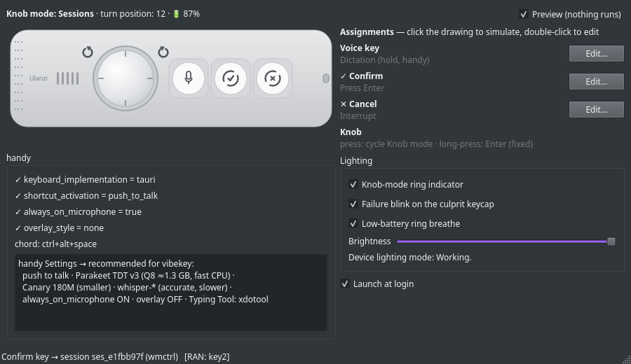
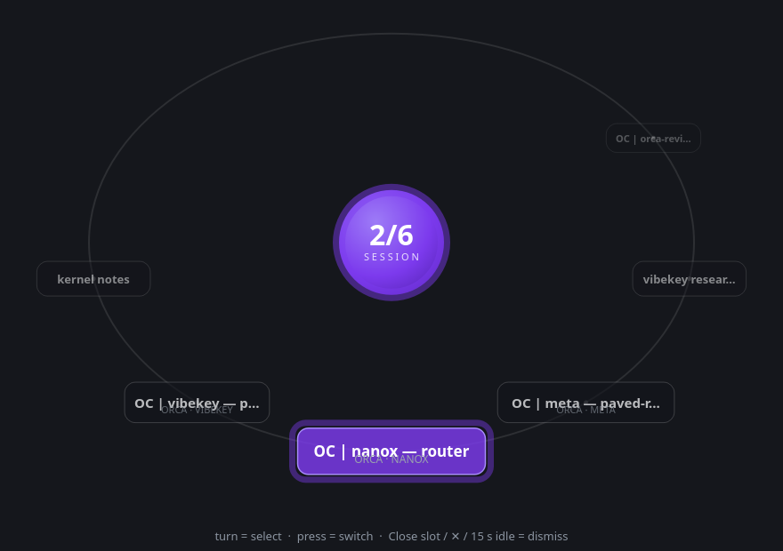

# vibekey

**Your AU05 keypad, reimagined as a KDE control surface.**

*vibekey* turns the [Ulanzi Vibekey AU05](https://www.ulanzi.com/products/au05-vibe-key-ai-voice-input-keypad-i018)
— a USB dial with two buttons everyone uses as Enter/Escape — into something far
more useful on **Manjaro KDE / X11**: one **Control** for Dictation, one for
your agent Sessions, one for stopping them, and a knob whose meaning you switch
with a press. Its factory keystrokes never reach your apps; the **Assignments**
you choose run instead.

It is a port of the excellent MIT-licensed
[jimmibram/vibekey-driver](https://github.com/jimmibram/vibekey-driver)
(see [UPSTREAM](UPSTREAM)), rebuilt for KDE with a PySide6 **Panel**,
[handy](https://github.com/cjpais/Handy) dictation, and first-class
OpenCode/Orca agent Presets — planned entirely as a
[wayfinder map](.wayfinder/map.md) and built to [spec.md](spec.md).



## What it does

| Control | Default | Meaning |
|---|---|---|
| 🎙 **Voice key** | **Dictation** | hold-to-talk via [handy](docs/presets.md#dictation) — release, and text appears (~0.5–2 s) |
| ✓ **Confirm** | **Next Session** | step the Ring of OpenCode Sessions; raises each Session's Host |
| ✕ **Cancel** | **Erase** | tap = back one character, hold ≥400 ms = one word; while the Wheel is open ✕ closes it |
| **Knob press** | open the **Wheel** | the on-screen carousel of Sessions; press again to **switch** to the selection (press on **Close** = dismiss) |
| **Knob long-press** | `Enter` | accepts agent permission prompts without touching the keyboard |
| **Knob turn** | move the **Ring** | Wheel open: selects only — no switch until you press; Wheel closed: steps and raises the Host live |

Every Control is reassignable from the Panel — presets, key combos, or shell
commands ([docs/presets.md](docs/presets.md)).

And it lights up: the knob ring pulses hand-tuned **rhythms**, flashes an
**alarm** when your agent waits for approval, culprit keycaps blink on
failure, and the ring breathes when the battery runs low
([docs/lighting.md](docs/lighting.md)).




## Install

```bash
./build.sh --install          # builds from HEAD, verifies, sudo pacman -U
gpasswd -a $USER vibekey      # the one manual step — then reboot (see below)
systemctl --user enable --now vibekeyd
```

Then open **vibekey Panel** from your applications. Full walkthrough with
verification checks: **[docs/getting-started.md](docs/getting-started.md)**.

> **Reboot beats logout** if you run lingering sessions or agent tools: a plain
> logout does not restart `user@1000.service`, which is what hands the
> `vibekey` group to the **Daemon**. Details in
> [docs/troubleshooting.md](docs/troubleshooting.md#no-permission-to-read-the-dongle).

## Documentation

| Page | Contents |
|---|---|
| [Getting started](docs/getting-started.md) | install, first run, Panel tour, autostart, uninstall |
| [Presets & Assignments](docs/presets.md) | every Preset, the control map, reassigning, writing custom commands |
| [Lighting](docs/lighting.md) | ring rhythms (with a rhythm catalogue), failure blinks, battery, device-mode ownership |
| [Configuration](docs/config.md) | the whole `config.json` schema, file protocol, where everything lives |
| [Troubleshooting](docs/troubleshooting.md) | the sharp edges we hit so you don't have to |

Architecture and every design decision live in
[spec.md](spec.md) — the buildable spec this project was planned to, with its
decision history in [.wayfinder/](.wayfinder/). Vocabulary is binding per
[GLOSSARY.md](GLOSSARY.md).

## The pieces

```
vibekeyd          resident daemon — reads the Dongle, owns the Grab, runs Assignments
vibekey-panel     tray + "drawn device" window (PySide6) — status, editing, Preview
vibekey-config    small atomic CLI the Panel uses to edit config.json
```

The Daemon and Panel never talk directly — only through a tiny file protocol
in `~/.config/vibekey/` and `$XDG_RUNTIME_DIR/vibekey/`
([docs/config.md](docs/config.md#the-file-protocol)), so either can restart
without disturbing the other.

## Requirements & credits

Arch/Manjaro, KDE Plasma on **X11**. Deps: `python pyside6 xdotool wmctrl
libnotify`; [handy](https://github.com/cjpais/Handy) (AUR) and
`orca` are optional but unlock the headline Presets.

- Daemon design and protocol work: [jimmibram/vibekey-driver](https://github.com/jimmibram/vibekey-driver) (MIT) — see [LICENSE](LICENSE), pinned in [UPSTREAM](UPSTREAM)
- AU05 protocol documentation: [MrCroxx/olanzi](https://github.com/MrCroxx/olanzi), [kubja/ulanzi-vibekey](https://github.com/kubja/ulanzi-vibekey), [palaemonboy/OpenVibeKey](https://github.com/palaemonboy/OpenVibeKey)
- Not affiliated with Ulanzi. Nothing secret ever lands in this public repo.
