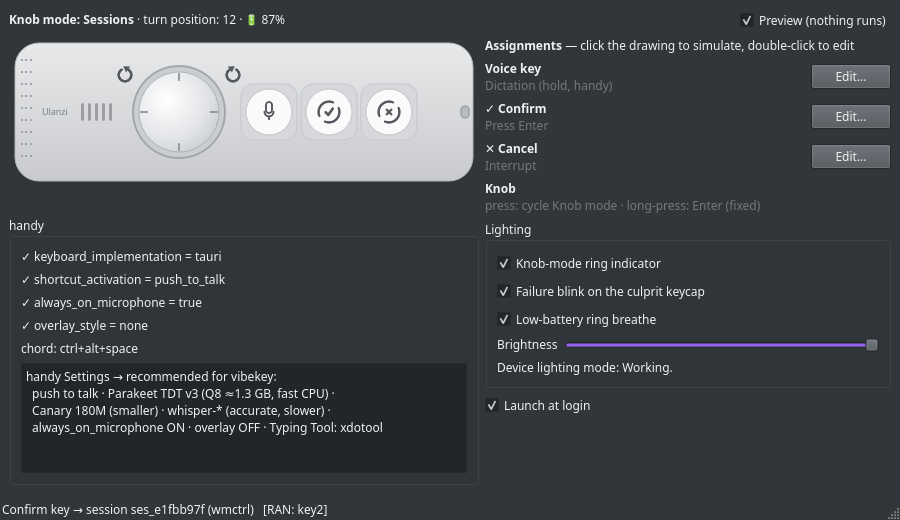

# Getting started

*[← README](../README.md)*

What you need, what to run, and how to see it working. Ten minutes, one reboot.

## 1 · Prerequisites

- **Manjaro/Arch, KDE Plasma, X11 session** — Wayland is out of scope for this port.
- An **AU05 with its Dongle** plugged in (`lsusb` shows `fff1:00dd`).
- Optional but recommended: **[handy](https://github.com/cjpais/Handy)** from the
  AUR for Dictation (the audited release is **0.10.1**) and **Orca** if you want
  the worktree Preset.

## 2 · Install

```bash
git clone https://github.com/jimOnAir/vibekey && cd vibekey
./build.sh --bump "local build" --install     # builds from HEAD, verifies, installs
```

(Plain `./build.sh` leaves the package in `dist/` for `sudo pacman -U`.)
`vibekeyd.service` ships **enabled-ready** but inactive; the udev rule and the
`vibekey` group install with the package.

## 3 · Grant device access (the one manual step)

```bash
gpasswd -a $USER vibekey
reboot
```

The Dongle re-enumerates on a hardware watchdog, so device nodes are recreated
constantly — the package's static group rule is what keeps them openable. A
plain logout usually does *not* help: user services inherit their group list
from `user@1000.service`, and that survives logout whenever lingering or
another session keeps it alive. **Reboot is the honest reset.** Verify:

```bash
systemctl --user status vibekeyd | head -3
python3 -c "import json; print(json.load(open('/run/user/$UID/vibekey/state.json'))['access'])"
# → ok
```

## 4 · Start the daemon

```bash
systemctl --user enable --now vibekeyd
```

You should hear nothing and see nothing — that is correct. The Daemon now holds
the Dongle's channels, **Grabs** its keystrokes (the factory Enter/Esc/
PrintScreen no longer reach X11), reads the battery, and publishes
`$XDG_RUNTIME_DIR/vibekey/state.json` for the Panel.

## 5 · Meet the Panel

Open **vibekey Panel** (applications menu, or `vibekey-panel`).



- The left half is a **drawing of your device**. A single click on a cap or the
  knob *simulates* it (status line, `[RAN (sim)]`); a **double-click opens the
  picker** so you can reassign it.
- The **header** shows the live Knob mode, turn position, and battery.
- The **status line** narrates everything the Daemon sees — while the Panel
  window is open, **Preview** is on by default: events are *reported*, nothing
  *runs*. Close the window (or uncheck Preview) and your Assignments fire.
- The **handy card** grades your dictation setup ✓/✗ — read-only, except the
  one consented **Fix handy** button.
- **Lighting** holds the feature switches (including the awaiting-approval
  *alarm ring*), the brightness slider, and (if your device mode says so) the
  consented **Manage lights** action ([docs/lighting.md](lighting.md#device-lighting-mode)).
- **Device (power & mic)** reads the keypad's own stored settings: standby
  minutes, sleep/power-off ("Never" included), and the dual-mic noise
  reduction — **Apply to the AU05** writes them into the device (consented;
  the values shown afterwards are read back from it).
- The tray icon mirrors the Knob mode with a corner glyph
  , grows an orange **!** when the Daemon
  needs attention, and shows an orange **mic-with-slash** badge whenever your
  **Dictation mic is unusable**: the AU05 Dongle is unplugged, the keypad is
  **asleep or switched off** (its USB/mic nodes stay — the Daemon asks the
  Dongle directly and knows), or the system audio has no/muted input. A mute
  switch on some *other* wired mic changes nothing in the audio stack, so it
  cannot warn; a two-second test recording is the proof there.

## 6 · Wire the optional half

**Dictation:** start handy, then in its Settings set *activation → push to
talk* and *always-on microphone → ON*. The Panel's handy card confirms ✓.
Now: close the Panel, hold the 🎙 cap over any text field, talk, release.

> handy lives in the tray — if you don't see it, check the Plasma tray
> overflow (`^`). The vibekey Daemon deliberately never starts other apps.

**Agent Presets:** run your OpenCode Sessions as usual (in terminals or Orca).
Nothing to configure — the Daemon discovers the running service by itself.

## 7 · Autostart the Panel (optional)

Tick **Launch at login** in the Panel — a standard XDG autostart entry,
reversible from KDE's own autostart settings.

## Uninstall

```bash
sudo pacman -Rns vibekey          # removes package files only
```

User state survives by design. To finish the teardown:

```bash
systemctl --user disable --now vibekeyd
gpasswd -d $USER vibekey
rm ~/.config/autostart/vibekey-panel.desktop
rm -rf ~/.config/vibekey
```

---

*Next: [Presets & Assignments](presets.md) — what each Control can do, and
how to make it do something else.*
